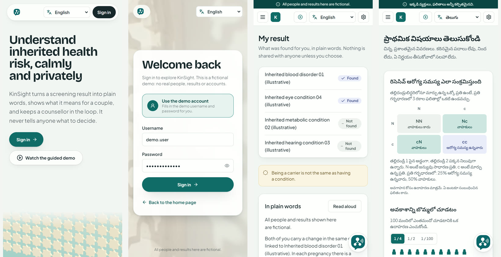
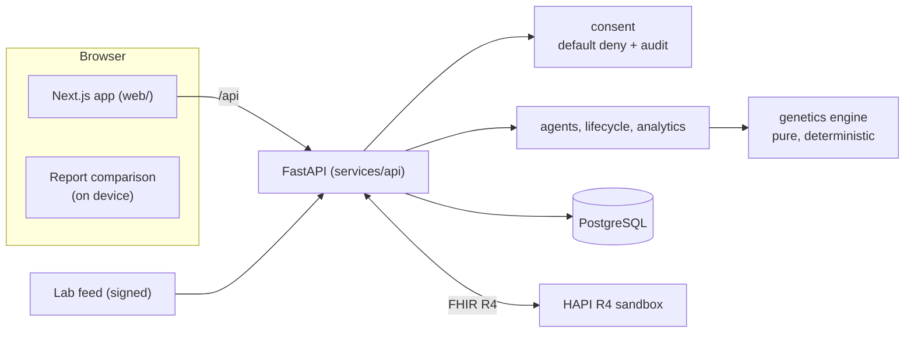

# KinSight

KinSight helps couples understand premarital carrier-screening results, explore what they mean for a family, prepare for genetic counselling, and control what they share. It was built for Challenge 03 of the Future Health Digital Innovation Challenge.

[](https://github.com/loktrishal-05/kinsight/actions/workflows/ci.yml)
[](https://github.com/loktrishal-05/kinsight/actions/workflows/codeql.yml)

[](LICENSE)

**[Open the live demo](https://kinsight-five.vercel.app/)** (fictional people and results) · [Architecture](docs/architecture/overview.md) · [What we built from the review feedback](docs/submission/judge-feedback.md) · [All documentation](docs/README.md)



## What it does

| Area | What a couple can do | Where |
| --- | --- | --- |
| Lab and health records | Receive results from a signed HL7 v2 / FHIR lab feed; import from and write referrals back to a FHIR R4 record (synthetic HAPI sandbox) | `/journey`, `/result` |
| Report reading | Upload a PDF or photo of a screening report, confirm each field against the source, compare both partners, and see engine estimates when both carry the same recessive condition. Reports never leave the device | `/report-compare` |
| Understanding | Plain-language explanation of one's own result in seven languages, a teach-back quiz, and Kin, an assistant that answers from the person's own data through fixed tools | `/result`, Kin |
| Planning | What-if scenarios (per pregnancy, at least one of N, untested partner, relationship), neutral descriptions of every route | `/plan/scenarios` |
| Preparation | A preparation sheet with tailored, neutral questions for the counsellor, shared section by section only by choice | `/prepare` |
| Family | An editable family tree, and cascade screening where relatives receive a condition-only invitation, never the sender's result | `/family`, `/cascade` |
| Care | One counsellor review queue, booking with calendar invites, content-free notifications | `/counsellor`, `/plan` |

Three guardrails hold everywhere: **default-deny consent** with a tamper-evident audit, every figure labelled an **educational estimate, not a diagnosis**, and **counsellor approval** before any complex or high-risk result is shown.

## Architecture



- The **genetics engine** is pure Python with no network, database or model access. Every figure comes from it, including the offline demo, which uses fixtures the engine exports.
- Backend packages form a **strict layer stack** (api, then workflow, then data, then core). Imports only point down, and a test enforces it ([`tests/unit/test_architecture.py`](tests/unit/test_architecture.py)).
- Every API route is **classified in a consent inventory**; an unclassified route fails CI.
- The optional **language model may only choose tools**; it never writes numbers or decides refusals.

Details: [architecture overview with diagrams](docs/architecture/overview.md) · [architecture decisions](docs/architecture/adr/) · [threat model](docs/architecture/threat-model.md)

## Repository layout

```
kinsight/
├── web/                  Next.js app: app/ (routes), components/, lib/ (API contract, mock + real adapters), messages/ (7 languages)
├── services/             Python backend, one package per layer (see services/README.md)
│   ├── api/              FastAPI: main.py (app factory), routes/ (one module per feature), demo/ (fictional data)
│   ├── agents/           explanations, Kin tools, preparation, referrals
│   ├── lifecycle/        lab tracking, review queue, booking, cascade, reference data
│   ├── analytics/        outcome measures with small-cell suppression
│   ├── cohort/           synthetic panel and people
│   ├── integrations/     FHIR R4 client, HL7 v2 parsing
│   ├── genetics/         deterministic engine
│   └── consent/          default-deny policy and audit chain
├── configs/              panel, wording, privacy, workflow and feature settings (YAML)
├── templates/            reviewed explanation templates per language
├── migrations/           Alembic database migrations
├── scripts/              fixture export, demo, mock lab, nightly ClinVar re-check
├── tests/                unit, integration, property, golden and red-team tests
└── docs/                 architecture, product, operations, research, submission (see docs/README.md)
```

## Run it

Python 3.11 and Node.js 22, as in CI.

**Web only, with the offline demo data**

```sh
cd web
npm ci
npm run dev            # http://localhost:3000
```

**Web, API and PostgreSQL**

```sh
cp .env.example .env   # PowerShell: Copy-Item .env.example .env
docker compose up --build
```

Set `NEXT_PUBLIC_MOCK=0` in `.env` before building to use the API. The UI is on port 3000 and the API health check on port 8000 at `/api/health`. To add the HAPI R4 sandbox and the signed lab feed, follow the [integration walkthrough](docs/operations/real-data-rollout.md).

## Test it

```sh
python -m pip install -e ".[dev,api]"
python -m ruff check . && python -m mypy
python -m pytest -q                      # about 840 tests
cd web && npm ci
npm run check                            # types, lint, 125 unit tests
npx playwright install chromium
npx playwright test --workers=1          # desktop and phone, axe WCAG 2.2 AA
```

[CI](https://github.com/loktrishal-05/kinsight/actions/workflows/ci.yml) also runs CodeQL, secret scanning, dependency audits, coverage floors and live tests against a HAPI R4 server. [Contributing](CONTRIBUTING.md) explains the pull-request and data-handling rules.

## Status and limits

- All people and results are **synthetic**. The FHIR and lab paths run against a seeded HAPI R4 sandbox and a synthetic signed feed; switching them on for real providers needs a partner, SMART launch and agreements ([rollout](docs/operations/real-data-rollout.md)).
- The genetics formulas and the non-English text **have not yet been reviewed** by a clinician or native speakers. A [review pack](docs/research/review-pack.md) is ready.
- The **comprehension study has not been run**; the [protocol](docs/research/study/protocol.md) and tooling are ready. No results are claimed.

[Limitations](docs/product/limitations.md) · [Data sources](DATA_SOURCES.md) · [Security](SECURITY.md) · [MIT licence](LICENSE)
