<div align="center">


# KinSight

**Understand inherited health risk, calmly and privately.**

A web application that turns premarital carrier-screening results into plain language, shows what they mean for a couple, prepares them for genetic counselling, and keeps every decision with the people and their counsellor.

[](https://kinsight-five.vercel.app/)
[](https://kinsight-api-va.onrender.com/api/health)

[](https://github.com/loktrishal-05/kinsight/actions/workflows/ci.yml)
[](https://github.com/loktrishal-05/kinsight/actions/workflows/codeql.yml)


[](LICENSE)

[Live demo](https://kinsight-five.vercel.app/) · [Video (EN)](https://kinsight-five.vercel.app/media/kinsight-explainer-en.mp4) · [Video (AR)](https://kinsight-five.vercel.app/media/kinsight-explainer-ar.mp4) · [Architecture](docs/architecture/overview.md) · [Review feedback, traced](docs/submission/judge-feedback.md) · [Documentation](docs/README.md)

<sub>Built for Challenge 03 of the Future Health Digital Innovation Challenge. All people and results in the demo are fictional.</sub>

</div>

---

## Contents

[Overview](#overview) · [Video](#video-explanation) · [Screenshots](#screenshots) · [Features](#features) · [System design](#system-design) · [Architecture](#architecture) · [Workflows](#workflows) · [Tech stack](#tech-stack) · [Repository layout](#repository-layout) · [Getting started](#getting-started) · [Quality](#testing-and-quality) · [Deployment](#deployment) · [Security and privacy](#security-and-privacy) · [Status](#status-and-limitations) · [Team](#team) · [License](#license)

## Overview

In communities where marriage between relatives is common, recessive conditions such as thalassaemia and cystic fibrosis are more frequent, and premarital screening is widespread. The results are hard to read, counselling time is short, and families worry about privacy and stigma.

KinSight sits between the screening result and the counselling session:

| For | KinSight provides |
| --- | --- |
| **Couples** | Their own result in plain words, in seven languages; what it means for a couple and for each pregnancy; what-if scenarios; a preparation sheet for the counsellor |
| **Families** | An editable family tree and a private way to suggest testing to relatives, who never see the sender's result |
| **Counsellors** | One review queue for complex findings, a case brief, and the couple's chosen questions before the session |
| **Programmes** | Outcome measures (understanding, preparation, uptake, cascade reach) with small cells suppressed |

Three guardrails hold on every screen: **default-deny consent** with a tamper-evident audit, every figure labelled an **educational estimate, not a diagnosis**, and **counsellor approval** before any complex or high-risk result is shown.

## Video explanation

<table>
  <tr>
    <td width="50%" align="center"><a href="https://kinsight-five.vercel.app/media/kinsight-explainer-en.mp4">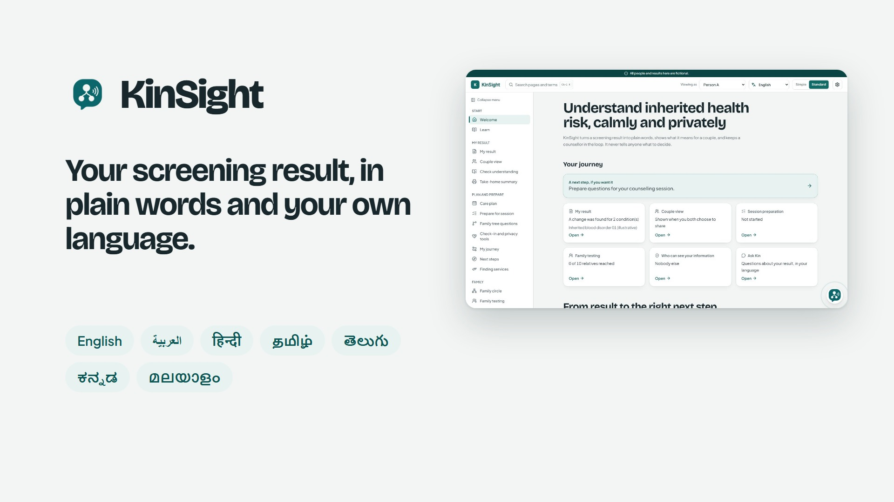</a><br /><b><a href="https://kinsight-five.vercel.app/media/kinsight-explainer-en.mp4">▶ Watch in English</a></b> · 77 s</td>
    <td width="50%" align="center"><a href="https://kinsight-five.vercel.app/media/kinsight-explainer-ar.mp4">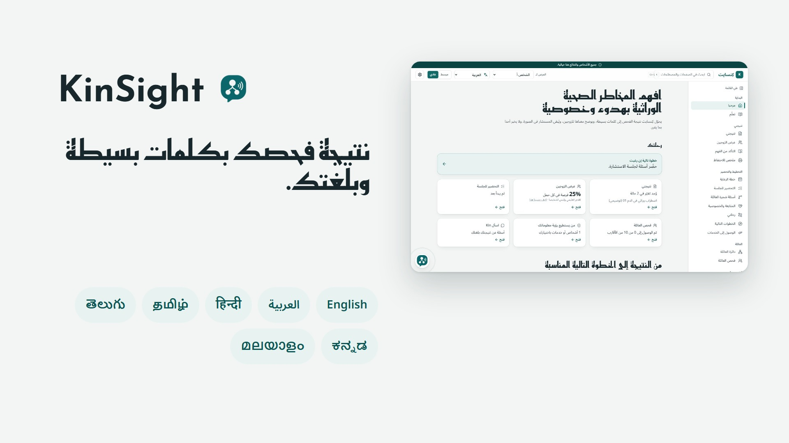</a><br /><b><a href="https://kinsight-five.vercel.app/media/kinsight-explainer-ar.mp4">▶ شاهد بالعربية</a></b> · 83 s</td>
  </tr>
</table>

Narrated walkthrough of the problem, the product and the architecture. The files are also in [`web/public/media/`](web/public/media/).

## Screenshots

<table>
  <tr>
    <td width="50%">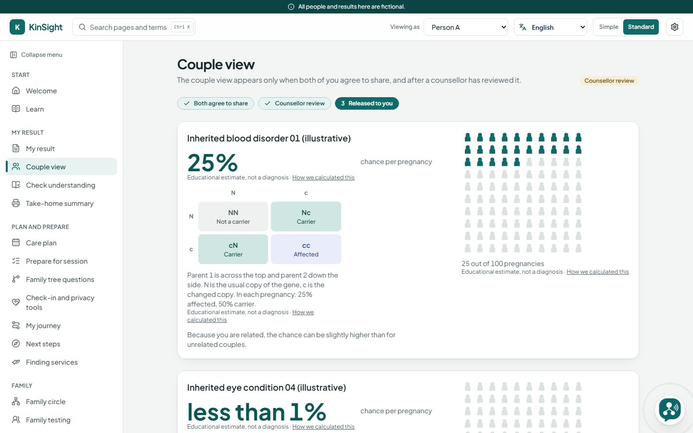<br /><sub><b>Couple view</b>: released only after both share and a counsellor reviews; every figure is labelled</sub></td>
    <td width="50%">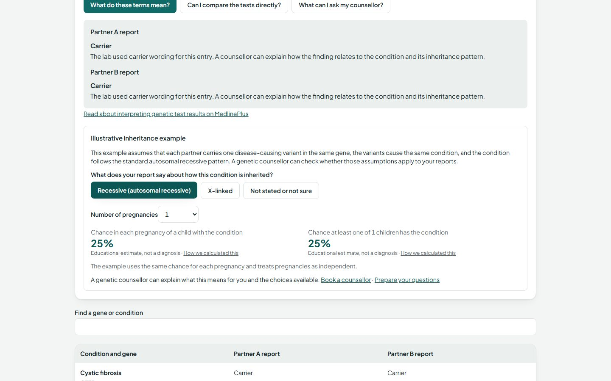<br /><sub><b>Report reading</b>: PDFs or photos read on the device, each field confirmed, then explored</sub></td>
  </tr>
  <tr>
    <td>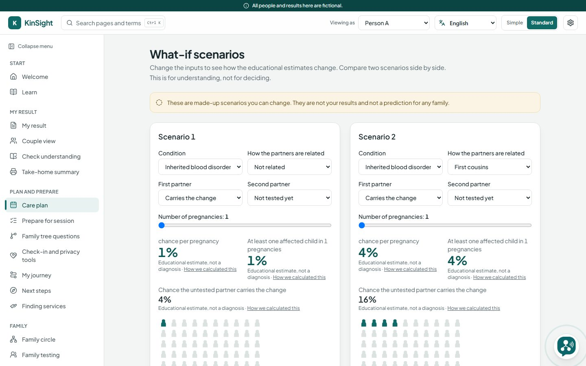<br /><sub><b>What-if scenarios</b>: per pregnancy, at least one of N, untested partner, relationship</sub></td>
    <td>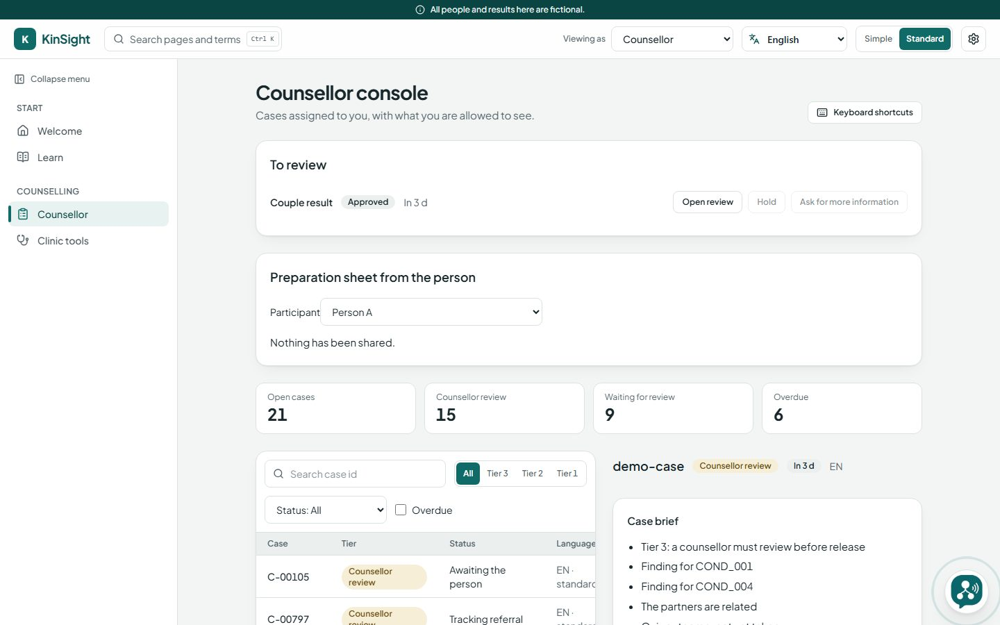<br /><sub><b>Counsellor console</b>: one review queue for complex findings</sub></td>
  </tr>
</table>

<p align="center">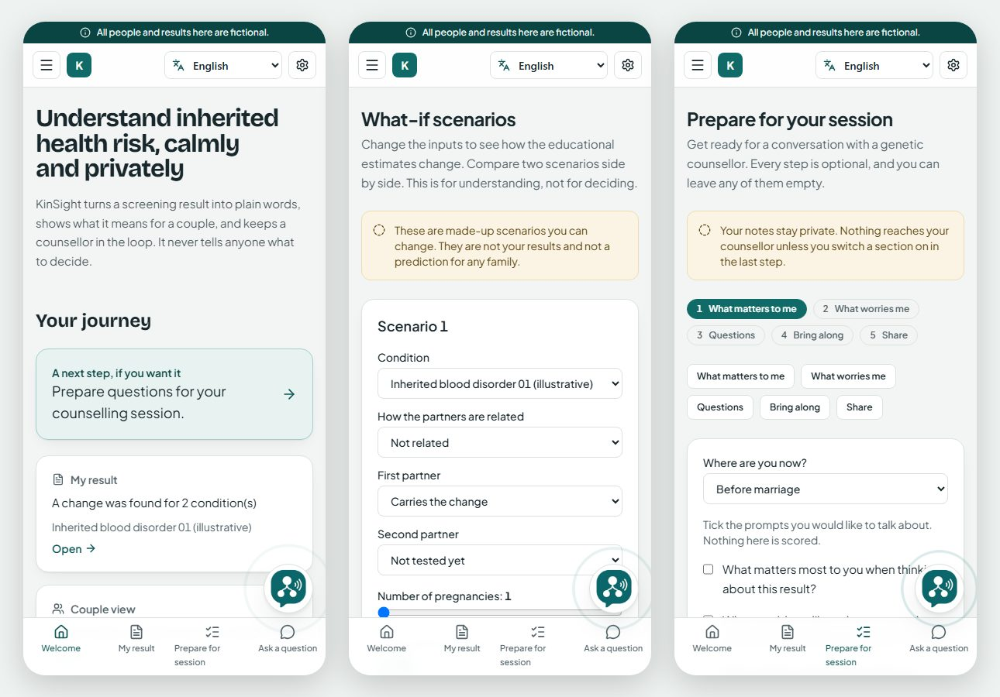<br /><sub>Phone layout in seven languages, installable as an app. More screens: <a href="https://kinsight-five.vercel.app/">open the live demo</a>.</sub></p>

## Features

| Area | Capability | Screen |
| --- | --- | --- |
| **Lab and EHR integration** | Signed HL7 v2 and FHIR lab feed with replay protection; FHIR R4 import and ServiceRequest/Task referral write-back against a HAPI R4 sandbox | `/journey`, `/result` |
| **Report reading** | PDF, text or photo read in the browser (local OCR), each field confirmed against the source, two reports compared, engine estimates for two carriers of the same recessive condition | `/report-compare` |
| **Understanding** | Plain-language explanation of one's own result, two reading levels, teach-back quiz with re-explanation, read-aloud and voice input | `/result`, `/understand` |
| **Kin assistant** | Answers from the person's own data through fixed, audited tools; refuses partner data; optional model mode can only choose tools | Kin, `/ask` |
| **What-if scenarios** | Per pregnancy and at least one of N children; untested partner by relationship; neutral description of each route | `/plan/scenarios` |
| **Preparation suite** | Values, concerns, tailored questions, a bring-along list and a printable sheet, shared per section | `/prepare` |
| **Family** | Editable pedigree; kinship computed by the engine; cascade screening with condition-only invitations and anonymous outcomes | `/family`, `/cascade` |
| **Care** | Unified counsellor review queue, booking with calendar invites and video link, service directory, content-free notifications | `/counsellor`, `/plan` |
| **Reference data** | MedlinePlus Genetics, ClinGen and Ensembl VEP with provenance; nightly ClinVar reclassification check | `/clinic` |
| **Outcomes** | Uptake, preparation, cascade reach and equity by language, small-cell suppression, table views and aggregate CSV | `/analyst` |

## System design

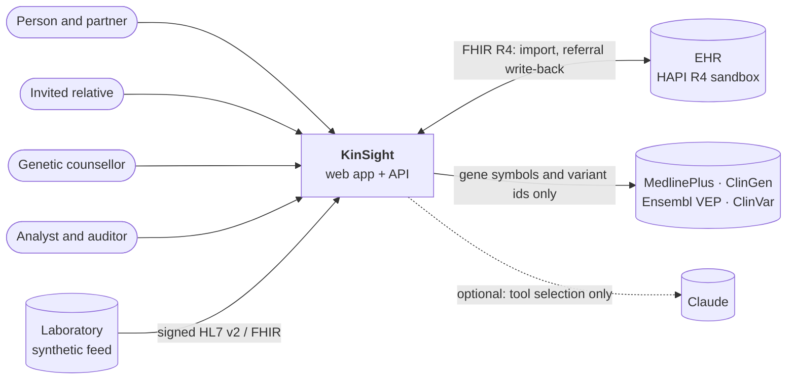

| Design decision | Why | Record |
| --- | --- | --- |
| Every figure comes from a pure, deterministic engine | Reproducible, testable numbers; no model ever writes a risk figure | [ADR 0001](docs/architecture/adr/0001-deterministic-core.md) |
| Default-deny consent with a hash-chained audit | Nothing personal is read without a recorded decision; tampering is detectable | [ADR 0002](docs/architecture/adr/0002-default-deny-consent.md) |
| Counsellor gate for complex findings | A person never meets a high-risk result alone | [ADR 0003](docs/architecture/adr/0003-counsellor-gate.md) |
| No bulk patient export route | Removes the easiest path for data to leave | [ADR 0004](docs/architecture/adr/0004-no-export-route.md) |
| Standards for integration (FHIR R4, HL7 v2) | Fits real EHRs and labs without bespoke adapters | [ADR 0005](docs/architecture/adr/0005-fhir-and-lab.md) |
| The language model is optional and only chooses tools | Refusals, numbers and wording stay deterministic and auditable | [ADR 0006](docs/architecture/adr/0006-optional-model.md) |

## Architecture

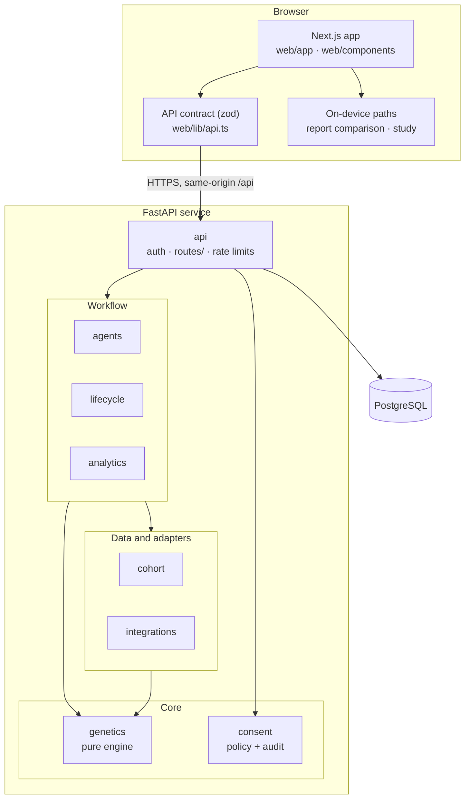

- **Layered backend.** Imports only point down: api, then workflow, then data, then core. [`tests/unit/test_architecture.py`](tests/unit/test_architecture.py) fails the build if a layer is crossed or if the genetics engine imports a network, database or model library.
- **One contract, two adapters.** The web app talks to `web/lib/api.ts`, which validates every response with zod. `real.ts` calls the API; `mock.ts` serves fixtures exported by the engine (`scripts/export_*.py`), so the offline demo shows the same numbers.
- **Every route is classified** as consent-checked, role-only, public or signed integration. An unclassified route fails CI.

Full details, with container and sequence diagrams: [architecture overview](docs/architecture/overview.md).

## Workflows

**1. From screening to a released couple result**

```mermaid
sequenceDiagram
    autonumber
    actor A as Person A
    actor B as Person B
    participant K as KinSight
    actor C as Counsellor
    A->>K: open own result (plain language, own data only)
    A->>K: share for couple planning
    B->>K: share for couple planning
    K->>K: engine assesses the couple; consent decisions audited
    alt complex or high-risk finding
        K-->>A: waiting notice (no figures)
        K->>C: item in the review queue with a case brief
        C->>K: approve (bound to this report revision)
    end
    K-->>A: couple view: estimate + label + method link
    A->>K: what-if scenarios, preparation sheet, book a session
```

**2. Lab feed and health-record integration**

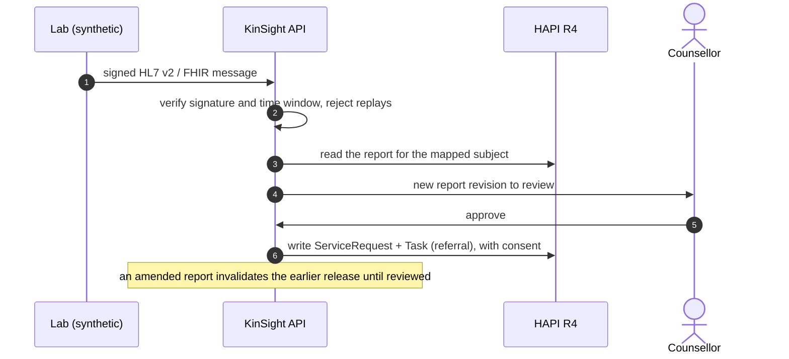

**3. Reading your own reports (on the device)**

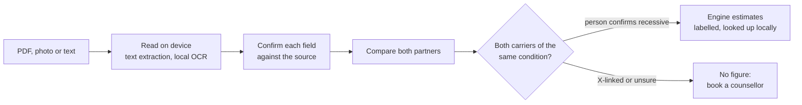

**4. Cascade screening.** The person picks relatives on the family tree; each receives a condition-only invitation with the engine's carrier chance for their relationship (1/2, 1/4, 1/8). Outcomes come back anonymously and never reveal who sent the invitation.

## Tech stack

| Layer | Technology |
| --- | --- |
| Frontend | Next.js 16, React 19, TypeScript 7, Tailwind CSS, TanStack Query, zod, three.js, Tesseract.js (on-device OCR) |
| Backend | Python 3.11, FastAPI, Pydantic 2, SQLAlchemy 2, Alembic, LangGraph (case workflow) |
| Standards | FHIR R4 (`fhir.resources`), HL7 v2 (`hl7`), HAPI FHIR server for the sandbox |
| Data | PostgreSQL (Neon in production), SQLite for tests |
| Quality | pytest and Hypothesis, Vitest, Playwright, axe-core, ruff, mypy, Biome, knip |
| Security | CodeQL, gitleaks, pip-audit and npm audit, strict CSP and security headers |
| Hosting | Vercel (web), Render (API, Docker), Neon (database), GitHub Actions (CI, keep-alive, nightly ClinVar) |

## Repository layout

```
kinsight/
├── web/                     Next.js app (see web/README.md)
│   ├── app/                 one folder per route
│   ├── components/          shared UI, app shell, Kin
│   ├── lib/                 API contract, real + mock adapters, browser logic
│   ├── messages/            translations (7 languages)
│   └── tests/ · e2e/        Vitest and Playwright
├── services/                Python backend, one package per layer (see services/README.md)
│   ├── api/                 app factory · routes/ (one module per feature) · demo/
│   ├── agents/              explanations, Kin tools, preparation, referrals
│   ├── lifecycle/           lab tracking, review queue, booking, cascade, reference data
│   ├── analytics/           outcome measures, small-cell suppression
│   ├── cohort/              synthetic panel and people
│   ├── integrations/        FHIR R4 client, HL7 v2
│   ├── genetics/            deterministic engine
│   └── consent/             default-deny policy, audit chain
├── configs/                 panel, wording, privacy and workflow settings
├── templates/               explanation templates per language
├── migrations/              Alembic migrations
├── scripts/                 fixture export, demo, mock lab, nightly ClinVar
├── tests/                   unit, integration, property, golden, red-team
└── docs/                    architecture · product · operations · research · submission
```

## Getting started

**Requirements:** Python 3.11 and Node.js 22 (as in CI). Docker for the full stack.

**Web only, with the offline demo data**

```sh
cd web
npm ci
npm run dev                  # http://localhost:3000
```

**Web, API and PostgreSQL**

```sh
cp .env.example .env         # PowerShell: Copy-Item .env.example .env
docker compose up --build    # web :3000, API :8000/api/health
```

Set `NEXT_PUBLIC_MOCK=0` in `.env` to use the API. To add the HAPI R4 sandbox and the signed lab feed, follow the [integration walkthrough](docs/operations/real-data-rollout.md).

**API alone**

```sh
python -m pip install -e ".[api]"
uvicorn services.api.main:app --reload
```

## Testing and quality

```sh
python -m pip install -e ".[dev,api]"
python -m ruff check . && python -m mypy
python -m pytest -q                       # ~850 tests: unit, integration, property, golden, red-team
cd web && npm ci && npm run check         # types, lint, 125 unit tests
npx playwright install chromium
npx playwright test --workers=1           # desktop and phone, axe WCAG 2.2 AA
```

| Check | Where |
| --- | --- |
| Layer rules and engine purity | `tests/unit/test_architecture.py` |
| Every route classified for consent | `tests/integration/test_route_consent_inventory.py` |
| Every figure carries the estimate label, in every language | `web/e2e/estimate-label.spec.ts` |
| WCAG 2.2 AA with zero axe violations on every page | `web/e2e/a11y.spec.ts` |
| Assistant refuses unsafe and out-of-scope requests (100+ prompts) | `tests/redteam/` |
| Live FHIR R4 integration | `web/e2e-live/`, run in CI against HAPI R4 |

CI also runs CodeQL, gitleaks, dependency audits and coverage floors on every pull request.

## Deployment

| Component | Platform | Notes |
| --- | --- | --- |
| Web app | [Vercel](https://kinsight-five.vercel.app/) | Deploys `main`; proxies `/api` to the API |
| API | [Render](https://kinsight-api-va.onrender.com/api/health) (Docker, Virginia) | `/api/health` makes a real database round trip |
| Database | Neon Postgres | Next to the API region |
| Keep-alive and nightly jobs | GitHub Actions | Prevents cold starts; nightly ClinVar reclassification |

The landing page shows a live status line. Details: [hosting](docs/operations/hosting.md).

## Security and privacy

- **Default deny**: no personal data is read without a recorded consent decision; partners, relatives and counsellors see only what was shared.
- **Tamper-evident audit**: every decision is appended to a hash chain; the governance page verifies it and demonstrates a tamper test.
- **Minimal data leaves**: only gene symbols or variant ids are sent to reference services; uploaded reports never leave the browser.
- **Hardening**: strict CSP and security headers, CORS allow-list, body-size caps, per-token rate limits, signed lab messages with replay protection.
- **Analytics**: aggregate only, with small cells suppressed; there is no bulk export route.

[Threat model](docs/architecture/threat-model.md) · [Security policy](SECURITY.md) · [Data sources](DATA_SOURCES.md)

## Status and limitations

- All people and results are **synthetic**. FHIR and lab integrations run against a seeded HAPI R4 sandbox and a synthetic signed feed; real providers need a partner, SMART launch and agreements ([rollout plan](docs/operations/real-data-rollout.md)).
- The formulas and the non-English text **have not yet been reviewed** by a clinician or native speakers; a [review pack](docs/research/review-pack.md) is ready.
- The **comprehension study has not been run**; the [protocol](docs/research/study/protocol.md) and tooling are ready. No results are claimed.

[Limitations](docs/product/limitations.md) · [Pilot readiness](docs/research/pilot-readiness.md) · [Changelog](CHANGELOG.md)

## Team

A team of four from **RMK College of Engineering and Technology (RMKCET), Tamil Nadu, India**.

| Member | Role |
| --- | --- |
| **Harshavardhan K** ([Harsha-code-per](https://github.com/Harsha-code-per)) | Team lead: web app, accessibility and documentation |
| **Loktrishal K** ([loktrishal-05](https://github.com/loktrishal-05)) | Architecture, genetics logic, privacy design, full stack |
| **Sanjjith B** ([Sanjjith27](https://github.com/Sanjjith27)) | Genetics engine and consent model |
| **Cholan** ([Cholan-kinnera](https://github.com/Cholan-kinnera)) | Research, user testing, demo and submission |

Contributions follow [CONTRIBUTING.md](CONTRIBUTING.md) and the [Code of Conduct](CODE_OF_CONDUCT.md).

## License

Released under the [MIT License](LICENSE). Copyright (c) 2026 Loktrishal Kanuparthy.

Third-party packages keep their own licences, listed in [docs/operations/licenses.md](docs/operations/licenses.md). Reference data sources and their terms are in [DATA_SOURCES.md](DATA_SOURCES.md).
