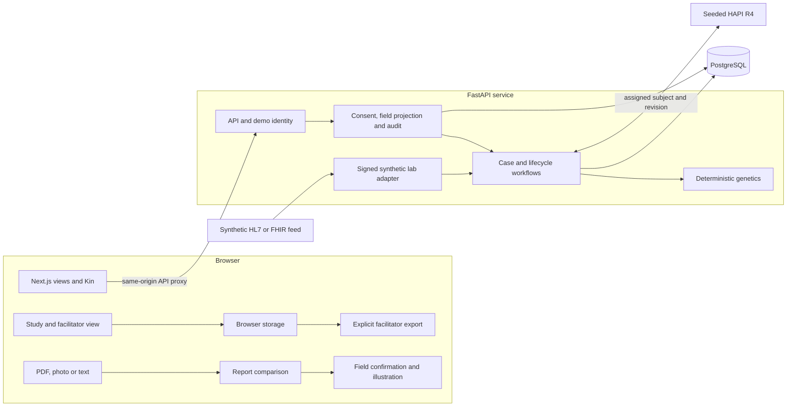

# KinSight architecture

The application has two data paths. The hosted synthetic workflow crosses an API trust boundary. Public report comparison and the facilitator’s study workflow use this browser as their data boundary.

## Responsibility and dependencies

| Boundary | Owner | Design decision |
| --- | --- | --- |
| Presentation | [web/app](../web/app), [web/lib](../web/lib) | UI renders typed estimates and labelled demo state. Mock mode uses fixtures generated from the Python engine. HTTP mode calls the API through the Next.js rewrite. |
| Request and access | [services/api](../services/api), [services/consent](../services/consent) | Demo tokens bind fictional roles. Consent decisions precede protected access. Responses expose permitted fields and audit decisions. The route inventory documents public and signed integration exceptions. |
| Calculation | [services/genetics](../services/genetics) | Deterministic Python functions use configured inputs. Genetics has no network or model dependency. Educational estimates travel with their basis and method link. |
| Release and follow-up | [services/agents](../services/agents), [services/lifecycle](../services/lifecycle) | The case graph selects and verifies template text. Complex results remain held for review. Partner sharing is independent and revocable. Referral closure requires evidence. |
| Integration | [services/integrations](../services/integrations), [services/api](../services/api) | The FHIR adapter verifies assigned subject and report version. The lab feed validates signatures and rejects replays. Corrections invalidate prior release until the replacement is reviewed. |
| Storage and reference | [migrations](../migrations), [services/cohort](../services/cohort) | Application state uses SQLAlchemy models and migrations. Synthetic cohort fixtures are seeded separately. Public reference lookups use gene symbols or variant identifiers. |

## Report and study paths

- **Browser report comparison.** File signatures and size/page limits are checked before reading. Supported text extraction and local OCR yield candidate fields. Evidence shows the PDF page only for a unique structured match. Users confirm fields against the original. Conflicting, annotated and multi-gene entries omit the illustrative figure. A simple matching row can open a hypothetical Mendelian example with explicit assumptions. This path operates independently of clinician-approved release.
- **Signed lab and FHIR path.** A fictional lab feed updates the assigned participant’s journey. The API reads the mapped HAPI subject, retains provenance and holds complex findings for approval. Consent and approval apply to the current report revision. The HAPI write-back example uses ServiceRequest and Task with explicit permission in its synthetic sandbox.
- **Study path.** A facilitator device stores anonymous fictional-case responses in local storage. Save and delete state reflects the browser operation. Readable rows can be exported locally, and an unreadable original remains available for recovery. The consent and comparative protocol require supervisor review before recruiting participants.

[Integration walkthrough](REAL_DATA_ROLLOUT.md) · [Study protocol](study/protocol.md) · [Threat model](THREAT_MODEL.md)

## Deployment and pilot boundary

Local Compose runs the web app, API and PostgreSQL, with HAPI available when explicitly started. The public demo runs on Vercel with the FastAPI service on Render and application state in Neon Postgres. The [hosting runbook](HOSTING.md) records the existing Render database dependency and service health checks.

The pilot requires a partner, approved clinical identity and report mappings, clinical and native-language review, and applicable data and study approvals. The [evaluator roadmap](EVALUATOR_ROADMAP.md) defines the acceptance gates.

## Architecture decisions

[Deterministic core](adr/0001-deterministic-core.md) · [Default-deny consent](adr/0002-default-deny-consent.md) · [Counsellor review](adr/0003-counsellor-gate.md) · [Patient export](adr/0004-no-export-route.md) · [FHIR and lab integration](adr/0005-fhir-and-lab.md) · [Optional model](adr/0006-optional-model.md)
