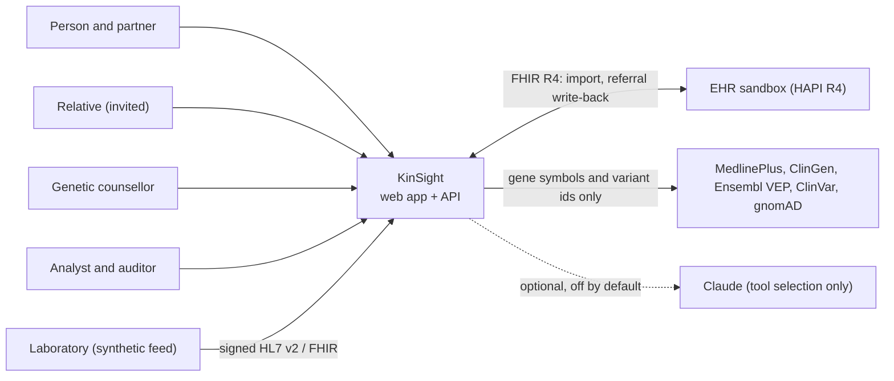
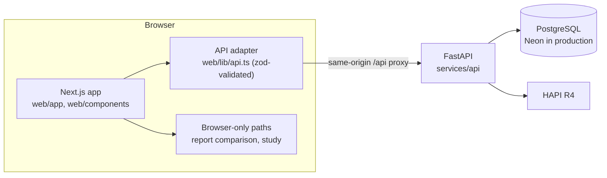
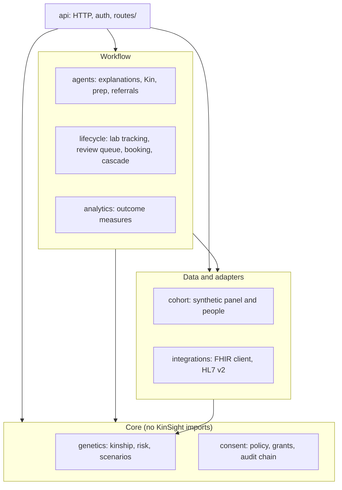
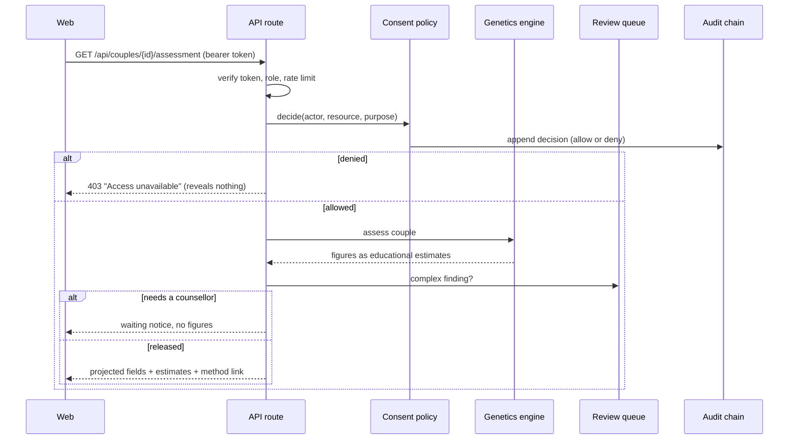

# KinSight architecture

KinSight is a web app (Next.js) on top of an API (FastAPI) with a deterministic genetics engine at its core. Four rules shape the design, each recorded as an architecture decision:

1. **Numbers come only from the engine.** Every risk figure is computed by pure Python functions and travels as an *educational estimate* with its basis and a method link ([ADR 0001](adr/0001-deterministic-core.md)).
2. **Default deny.** No personal data is read without a recorded consent decision, and every decision is audited in a hash chain ([ADR 0002](adr/0002-default-deny-consent.md)).
3. **Counsellors gate complex findings.** High-risk results wait in one review queue; the person sees a waiting notice, not the result ([ADR 0003](adr/0003-counsellor-gate.md)).
4. **Models never decide.** The optional language model may only choose tools; refusals, numbers and wording stay deterministic ([ADR 0006](adr/0006-optional-model.md)).

## Context

Only gene symbols or variant identifiers ever leave the servers for reference lookups. All people and results are synthetic.

## Containers

The adapter has two interchangeable implementations: `real.ts` (HTTP) and `mock.ts` (fixtures exported from the Python engine by `scripts/export_*.py`, kept in sync by tests). The mock never computes a figure, so the offline demo and the hosted app show the same numbers.

## Layers (backend)

Imports only point down. The rule is enforced by [`tests/unit/test_architecture.py`](../../tests/unit/test_architecture.py), which also checks that the genetics engine never imports network, database or model libraries.

| Package | Responsibility | Depends on |
| --- | --- | --- |
| [`services/genetics`](../../services/genetics) | Kinship coefficients, carrier and couple risk, what-if scenarios, cascade chances | nothing |
| [`services/consent`](../../services/consent) | Roles, grants, field projection, default-deny decisions, hash-chained audit ([decisions](consent-decisions.md)) | nothing |
| [`services/cohort`](../../services/cohort) | Synthetic condition panel and cohort | genetics |
| [`services/integrations`](../../services/integrations) | FHIR R4 client, referral write-back, HL7 v2 parsing | cohort |
| [`services/lifecycle`](../../services/lifecycle) | Lab tracking, counsellor review queue, booking, cascade tracking, reference data | genetics, cohort |
| [`services/agents`](../../services/agents) | Case graph, verified templates, teach-back, preparation, Kin tools | genetics, cohort |
| [`services/analytics`](../../services/analytics) | Outcome measures with small-cell suppression, capacity simulation | consent, lifecycle |
| [`services/api`](../../services/api) | `main.py` app factory and core routes; `routes/` one module per feature; `demo/` fictional data | all of the above |

## A protected request

Every route is classified in a route inventory (`tests/integration/test_route_consent_inventory.py`): consent-checked, role-only, public, or signed integration. A new route without a classification fails CI.

## Data paths

- **Hosted workflow.** The person, partner, counsellor and relatives work through the API. State lives in PostgreSQL (SQLAlchemy models, Alembic migrations in [`migrations/`](../../migrations)).
- **Browser-only report comparison** (`/report-compare`). PDFs and photos are read on the device (text extraction and local OCR); the person confirms each field against its source. When both reports list a carrier result for the same condition and the person confirms recessive inheritance, the engine's figures are looked up on the device. Reports never leave the browser.
- **Signed lab and FHIR path.** A synthetic lab feed signs each message; the API checks the signature and time window, rejects replays, and binds approval to the report revision. Corrections invalidate the previous release until a counsellor reviews the replacement.
- **Study path.** A facilitator device stores anonymous responses to fictional cases in local storage, exported explicitly.

## Cross-cutting concerns

| Concern | How |
| --- | --- |
| Security | Strict CSP and security headers, CORS allow-list, body-size caps, per-token rate limits, CodeQL and gitleaks in CI ([threat model](threat-model.md)) |
| Privacy | Default-deny consent, field projection, audit chain, small-cell suppression in analytics, no export route ([ADR 0004](adr/0004-no-export-route.md)) |
| Safe wording | Estimates always labelled; banned and stigmatising phrases checked (`configs/wording.yaml`); neutral, non-directive options |
| Languages | Seven languages including Arabic right-to-left; untranslated text falls back to English and says so |
| Accessibility | WCAG 2.2 AA checked by axe on every page, keyboard journey tests ([accessibility](../product/accessibility.md)) |
| Testing | About 840 Python tests (unit, integration, property, golden, red-team), 125 web unit tests, Playwright on desktop and phone |

## Deployment

The web app runs on Vercel and proxies `/api` to the FastAPI service on Render, which uses Neon Postgres. A keep-alive workflow prevents cold starts; `/api/health` makes a real database round trip. Locally, `docker compose up` runs the web app, API and PostgreSQL. See [hosting](../operations/hosting.md).

## Architecture decisions

[0001 Deterministic core](adr/0001-deterministic-core.md) · [0002 Default-deny consent](adr/0002-default-deny-consent.md) · [0003 Counsellor review](adr/0003-counsellor-gate.md) · [0004 No patient export route](adr/0004-no-export-route.md) · [0005 FHIR and lab integration](adr/0005-fhir-and-lab.md) · [0006 Optional model](adr/0006-optional-model.md)
